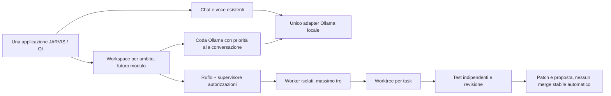

# JARVIS FUSION — piano di integrazione progressiva

Analisi del 15 novembre 2026. JARVIS in `C:\Users\VGgot\Desktop\JARVIS`
rimane il prodotto principale. PersonalJarvis 2.7.1 è esclusivamente la sorgente
locale di confronto; non viene installato o avviato come seconda applicazione.

## Sorgenti, verifica e protezione

- JARVIS: commit stabile `3346034ef9d329893ce644a98a7df84f043ba40f`;
  176 test di baseline superati prima dell'integrazione.
- PersonalJarvis: archivio fornito `C:\Users\VGgot\Downloads\PersonalJarvis-main.zip`,
  189.467.151 byte, 10.576 voci, SHA-256
  `b29edfaf0a117bd31697e511f66b451014959074c75ce6ae8cf08e6581e3b306`.
- Inventario strutturale dell'intero Python: **1.446 file applicativi e 2.469
  file di test** analizzati con AST, senza importare o eseguire quel codice.
  Approfonditi i moduli indicati nel brief e i componenti confrontati sotto.
  L'analisi statica e la presenza di test non dimostrano da sole prestazioni,
  sicurezza completa o funzionamento sul PC dell'utente.
- Analisi locale: `.development-state/personaljarvis-analysis/inventory.json`.
  Nessun installer, hook, AGENTS.md, script remoto o istruzione presente nello
  ZIP è stato adottato come autorizzazione o eseguito.
- Backup verificato:
  `.development-state/fusion-backup-20261115T113918Z-c34d4a/`.
  Contiene bundle Git di tutti i branch, 201 file di lavoro/configurazione
  con hash e snapshot SQLite coerente mediante backup online, `quick_check=ok`.
  Il manifest ne specifica esattamente l'ambito. Cache dei modelli, profilo
  browser e strumenti restano al loro posto e non vengono modificati.
- Branch dedicato `codex/jarvis-fusion`, worktree
  `.development-state/fusion-worktree/`. Il checkout principale, gli altri
  worktree, i file personali non versionati e i buffer dell'IDE non vengono
  sovrascritti. Non è stato cambiato alcun editable install della `.venv`.

## Decisione architetturale

Conservare Qt/PySide6, il controller, la voce e il database dell'attuale
JARVIS. Integrare componenti o principi di PersonalJarvis attraverso interfacce
piccole, con test pertinenti e mantenendo i confini di sicurezza.

PersonalJarvis dichiara Python 3.11–3.14, più provider cloud, FastAPI/WebSocket,
frontend web, un event bus asincrono, diversi registri e scheduler. Richiede
molte dipendenze aggiuntive. JARVIS usa Python 3.12, Qt e quattro dipendenze
dirette: sostituire il bootstrap o il package `jarvis/` sovrapponendo i due
alberi introdurrebbe collisioni, configurazioni incompatibili e regressioni.
Non si trasferiscono i requisiti upstream in blocco.

La compatibilità Windows di PersonalJarvis è dichiarata nel suo packaging e
si riconoscono percorsi/subprocessi dedicati alla piattaforma. Non significa
compatibilità immediata con questa app: asyncio/FastAPI, PySide/WebEngine,
database e percorsi utente hanno lifecycle diversi. Le funzioni pure sono
portabili subito; worker nativi, browser, audio e servizio in background
richiedono invece adapter e prove Windows specifiche. La verifica locale
effettiva del primo modulo è riportata separatamente dai riscontri statici.

## Confronto e scelta per componente

Per ciascuna area sono considerati comportamento reale del codice, dipendenze,
test reperiti, compatibilità Windows, confini di sicurezza e costo di
integrazione. Le prestazioni di PersonalJarvis non sono state misurate sul PC:
non si deduce superiorità dal numero di file o dai benchmark descritti nei commenti.

| Area | JARVIS attuale / alternativa PersonalJarvis | Scelta motivata |
| --- | --- | --- |
| AI e ragionamento | `core/agent.py`: tool loop, selezione rapida, esiti verificati. Alternativa `brain/tool_use_loop.py`, planner, evidence gate e iteration budget | Mantenere il percorso rapido già misurato. Integrare gradualmente budget per fase e riferimenti alle evidenze; evitare un secondo controller o un secondo classificatore per ogni turno |
| Ollama | Adapter HTTP loopback, cancellazione, Qwen 9B, preload. Alternativa `brain/ollama_inventory.py`, runtime/profiles e pool HTTP | Primo modulo: inventario in sola lettura attraverso l'adapter esistente. Installato e caricato sono stati diversi; contesto nativo e attivo restano distinti. Nessun pull, delete, unload o alias automatico |
| Conversazioni | Messaggi SQLite e contesto limitato. Alternativa `agent_chat/store.py`, service, turn completion e voice mirror | Conservare la chat attuale; aggiungere canali e messaggi con ID stabili nello stesso prodotto mediante migrazione additiva, senza duplicare messaggi tra due database |
| Memoria | Registro messaggi, task, operazioni e preferenze. Alternativa `memory/core_memory.py`, `recall.py` FTS5/BM25 e wiki | Valutare fatti utente e ricerca FTS5 locale. Non importare campi di reasoning grezzo: il recall upstream può indicizzarli, mentre questo progetto li esclude. Nessun modello embedding aggiuntivo necessario per FTS5 |
| Wake word | Modello ONNX personalizzato «Jarvis», gate e preroll. Alternativa `plugins/wake/openwakeword_provider.py`, normalizzazione e campioni | Mantenere il modello già funzionante e l'attivazione senza «Hey». Portare solo eventuali correzioni di normalizzazione dimostrate su registrazioni autorizzate |
| STT | Whisper-small CPU int8, worker persistente e preload. Alternativa `voice_engine/stt.py` Parakeet/sherpa-onnx e plugin STT | Conservare Whisper già presente. Parakeet richiederebbe runtime/pesi nuovi e un confronto italiano; non scaricarli nel primo modulo. Valutare endpointing speculativo dopo prova di cancellazione |
| TTS | Cosimo locale, PCM reale, STOP e misuratore. Alternativa `plugins/tts/piper_local.py`, Pocket/Qwen TTS | Conservare Cosimo. Preparare in futuro campioni A/B di un candidato locale, con licenza del motore e del singolo modello verificata; non cambiare voce prima dell'ascolto e approvazione |
| Pipeline vocale | QtAudio, esclusione eco, follow-up, overlay e barriera prima delle azioni. Alternativa `audio/vad.py`, capture/player/echo e Silero con fallback | Mantenere un solo capture/player. Valutare il VAD come modulo separato: non avviare simultaneamente due pipeline audio o condividere una stessa istanza ONNX/CTranslate2 tra chiamanti |
| Controllo Windows | Strumenti registrati, UIA e azioni strutturate. Alternativa skill/controlli desktop e gateway strumenti | Conservare permessi ed evidenze attuali; aggiungere operazioni mancanti attraverso lo stesso registro. Non trasferire terminali generici o policy permissive |
| Browser automation | Adapter CDP e flussi dedicati. Alternativa `control/browser.py`, `society/browser/` e adapter CLI/Playwright | Consolidare una sola interfaccia browser. Una futura integrazione Playwright richiede dipendenza/browser dedicati e test di login, cancellazione e verifica; non importare automaticamente profili o sessioni |
| Computer vision | Rendering e screenshot tecnici, non un tool visivo generale del modello. Alternativa `vision/context_provider.py`, engine, cache, vision gate | Progettare cattura su richiesta di una finestra autorizzata e scadenza del contesto. Non attivare la cattura periodica dello schermo presente nell'alternativa. Capacità vision dichiarata dal modello non equivale a visione integrata |
| Agenti AI | Quattro ruoli realmente collaudati su fixture, catalogo Ruflo e ricevute OS. Alternativa `agents/registry.py` e mission worker | Riutilizzare executor e isolamento esistenti; adottare trace ID espliciti. Non usare come prova di esecuzione un nodo UI, un evento di avvio o il collegamento euristico al worker più recente |
| Orchestrazione | Ruflo 3.77.1 e supervisore locale. Alternativa `society/runtime.py`, scheduler, bridge e roster | Un solo piano di controllo: Ruflo per coordinamento/task, policy locale per autorizzazioni, ricevute per esiti. Integrare un protocollo di messaggi e responsabilità, senza copiare un secondo orchestratore completo |
| Chat per ambito | Command Center in worktree separato; nessuna conversazione agentica persistente generale. Alternativa `society/rooms.py`, bus/store e agent_chat | Integrare nel Workspace della stessa finestra cinque canali richiesti. Messaggi reali collegati a task/run/test, niente riempimento grafico. Utente può intervenire e fermare il lavoro |
| Scheduler | Solo collaudo one-shot; nessun backlog generale continuo attivo. Alternativa `tasks/scheduler.py`, heap persistente e trigger; society scheduler | Costruire una coda autorizzata e limitata sul runner Ruflo, riusando principi di persistenza e cancellazione. Non installare cron/scheduler/event-loop paralleli per lo stesso compito |
| Git worktrees | Worktree di task, base SHA e patch controllate; main protetto. Alternativa `missions/isolation/worktree.py` con sidecar base SHA, gestione percorsi Windows e archiviazione | Adottare confronto rispetto alla base iniziale anche se il worker commette. Conservare deliverable separati dalla pulizia; non attivare sweep o rimozioni automatiche dell'alternativa |
| Autorizzazioni | Schemi chiusi, conferme concrete, MXC per worker, dati esterni non fidati. Alternativa `agent_chat/permissions.py` con scale per runner e blacklist | Mantenere le policy più restrittive. Una scala UI non è un'autorizzazione OS. Non importare bypass, full-access o conferme automatiche come default |
| Interfaccia | Qt, nucleo WebGL ambra e ispezione nodi già integrati. Alternativa frontend web, agentic IDE e messaggistica | Mantenere identità, rendering e una sola app. Adattare sidebar/canali e pannello task al Qt attuale; non installare un secondo frontend/server per ottenere solo la messaggistica |
| Logging | JSON locale rotante, senza prompt/argomenti sensibili. Alternativa logging strutturato, tracing e telemetria | Conservare logger locale e aggiungere run/channel/stage ID. Non importare telemetria remota o memorizzazione di prompt/reasoning negli alberi agente |
| Errori e recupero | TaskContext, STOP, timeout, retry di letture guidato da evidenze. Alternativa cancel token, watchdog, jitter e recovery pipeline | Integrare recuperi selettivi e budget; scritture/invii con esito incerto richiedono verifica prima di ripetere. Nessun loop infinito per coprire una funzione mancante |
| Configurazione | JSON/.env locale e preferenze SQLite. Alternativa Pydantic/TOML, config_writer atomico, directory utente e profili | Conservare formati e percorsi esistenti. Un futuro writer unico farà migrazioni additive e atomiche. Non creare `jarvis.toml` parallelo o importare chiavi/configurazioni upstream |
| Sicurezza e lifecycle | Single instance, processi posseduti, nessun servizio Windows necessario. Alternativa `core/background_service.py` con handover a servizio utente | Conservare single-instance/tray e separazione dei worker. Non avviare il background service alternativo o servizi SYSTEM. CPU/RAM/tempo restano limitati; niente release o main automatici |

Test upstream reperiti includono `tests/unit/brain/test_ollama_inventory.py`,
`tests/unit/agents/test_registry.py`, `tests/missions/test_worktree.py`,
test di society, scheduler, VAD e permessi. La suite PersonalJarvis non è stata
eseguita in blocco: richiede il suo stack e contiene test di integrazione con
servizi non configurati. Le parti portate saranno verificate nei test di JARVIS.

## Primo modulo scelto: inventario locale Ollama

Obiettivo: offrire nella stessa applicazione una lettura verificabile di
modello configurato, modelli installati, capacità dichiarate, contesto nativo,
stato di caricamento e memoria attribuita da Ollama.

Si adattano le piccole funzioni pure di confronto nomi e contesto nativo di
`brain/ollama_inventory.py`, conservando attribuzione Apache-2.0. Il trasporto
rimane `OllamaProvider`: nessun httpx, pool asincrono o provider duplicato.
Gli interi e le dimensioni vengono validati; un `/api/ps` indisponibile produce
«non verificato», non «modello scaricato» o «VRAM zero».

L'inventario completo è richiesto soltanto dalla verifica provider/pannello
modello. Il percorso normale delle risposte conserva le sue due verifiche
leggere e non effettua scansioni ripetute di tutti i modelli. Nessuna generazione,
download, cancellazione, unload, modifica al modello o al database è necessaria.
Questo modulo prepara la futura gestione risorse, ma **non è ancora una coda
con priorità o un sistema multi-agente completo**.

## Moduli successivi, uno alla volta

1. **Memoria e conversazioni:** nuove tabelle additive per fatti e canali,
   migrazione/versione esplicita, ricerca FTS5 opzionale, ID messaggio idempotenti,
   nessun reasoning grezzo. Conservare la cronologia e le operazioni attuali.
2. **Sistema agentico:** task chiusi e autorizzati, ricevute con trace/run ID,
   obiettivo, responsabile, stato, budget, test e condizioni di completamento.
   Massimo **tre agenti attivi**, un solo autore per file. Worktree per task;
   main stabile e pubblicazioni sempre fuori dal dispatch automatico.
3. **Coda Ollama condivisa:** coda reale tra processi, una generazione locale
   per volta, precedenza alle richieste vocali. I lavori secondari attendono o
   cedono tra chiamate, senza promettere preemption di un'inferenza già in corso.
   Niente tre copie del modello in VRAM; nessun fallback a chiavi cloud.
4. **Workspace integrato:** sidebar con `# intelligenza-artificiale`,
   `# sistema-vocale`, `# interfaccia`, `# automazione-windows`,
   `# testing-e-sicurezza`. Ogni canale mostra ruoli diversi, messaggi reali,
   streaming, file modificati, test e revisioni. Nessuna conversazione inventata
   e nessuna animazione usata come prova di un agente attivo.
5. **Discussioni utili e finite:** adattare il modello rooms di PersonalJarvis:
   turni seriali, budget e silenzio ammesso. L'output di una discussione non
   conta come codice/test eseguito. Proposte nuove restano nel backlog finché
   autorizzate; nessun messaggio automatico senza scopo.
6. **Autonomia Windows/browser/visione:** strumenti aggiuntivi nel registro
   esistente, osservazioni prima/dopo, approvazione dell'invio esatto e dei
   cambiamenti sensibili, isolamento di contenuti esterni e test offline prima
   dei servizi personali. Non richiedere credenziali per una prova di laboratorio.
7. **Voce e grafica:** campioni locali confrontabili, misure di latenza/STOP,
   eventuale VAD e TTS solo dopo verifica di qualità italiana e licenze. Il
   nucleo neurale rappresenta attività e PCM reali, non pesi o ricordi di Qwen.
8. **Integrazione finale:** un solo avvio JARVIS, Workspace nella stessa app,
   test completi e prova microfono → AI → azione → risposta. Integrare in stable
   soltanto dopo revisione del modulo; non sommare i due bootstrap.

Ogni modulo deve superare test pertinenti, regressione e verifica delle prove
prima del successivo. Backlog vuoto: inattività. STOP cancella coda e worker
posseduti, non processi arbitrari. Un riavvio ricostruisce lo stato e distingue
task riprendibili da scritture con risultato incerto.

## Dipendenze e licenze

Nessuna dipendenza nuova per il primo modulo. PersonalJarvis dichiara
Apache-2.0, copyright 2026 Ruben Lütke. Per le parti adattate si conservano
`LICENSE` e `NOTICE` originali sotto `third_party/PersonalJarvis/`, più elenco
dei file e delle modifiche. Questo non cambia automaticamente la licenza
dell'intero progetto JARVIS né trasferisce licenze di modelli/asset non copiati.
Voce e modelli futuri richiederanno verifica delle rispettive licenze specifiche.

## Rollback e stato della consegna

La versione stabile rimane già disponibile nella root principale: per usarla
basta il suo `Avvia_JARVIS.bat`. Non avviare il bootstrap PersonalJarvis né fare
`pip install -e` dal worktree. Nessuna migrazione del database personale nel
primo modulo. Il bundle e la copia SQLite del backup sono verificabili dal
manifest; una loro eventuale ripristino va eseguito con l'app chiusa, senza
sovrascrivere automaticamente dati più recenti.

Lo stato implementato del primo modulo e i risultati effettivi dei test saranno
registrati in `docs/fusion-module-1.md`. Le chat per ambito e il backlog generale
restano moduli successivi: non vengono dichiarati operativi dal solo piano.
