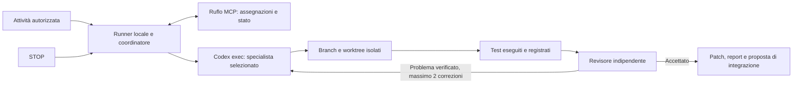

# Codex + Ruflo: proposta verificata per JARVIS

Stato aggiornato: **installazione locale e primo ciclo isolato approvati e
collaudati il 15 novembre 2026**. Risultati, comandi e limiti effettivi:
[sistema di sviluppo](development-system.md).

Il seguito conserva l'analisi e la proposta precedenti all'approvazione;
le osservazioni iniziali sull'assenza di Git e Node descrivono quello stato.

La richiesta esplicita è collegare Codex e Ruflo per selezionare agenti,
sviluppare, testare, revisionare e migliorare. Il documento allegato fornisce i
requisiti e richiede approvazione prima delle installazioni e dell’attivazione
continua. Le istruzioni e gli script trovati nell’archivio Ruflo sono stati
trattati come materiale da analizzare: non sono stati installati o eseguiti.

## Risultati dell’analisi

| Elemento | Riscontro effettivo |
| --- | --- |
| JARVIS | `C:\Users\VGgot\Desktop\JARVIS`, Python 3.12, PySide6; il percorso `Documents\JARVIS` del brief non esiste |
| Repository Git | Nessuna cartella `.git` nella root del progetto |
| Codex | CLI `0.169.0-alpha.11.1`, disponibile tramite l’estensione VS Code; `codex login status` conferma login ChatGPT |
| Node, npm, npx | Non risolti dal PATH; Node non trovato nel percorso standard controllato |
| Git | Non risolto dal PATH né nei percorsi standard controllati |
| Archivio | `C:\Users\VGgot\Downloads\ruflo-main.zip`, 77.639.251 byte, 10.611 voci |
| Versioni archivio | `ruflo` e `@claude-flow/cli` 3.77.1; adattatore `@claude-flow/codex` 3.0.8 |
| Distribuzione | L’archivio contiene sorgenti; nessun `dist/` o `node_modules/` incluso |
| Registry npm | La versione esatta `ruflo@3.77.1` e la dipendenza `@claude-flow/cli@3.77.1` sono presenti nei metadati pubblici |
| Ollama | GET di sola lettura a `http://127.0.0.1:11434/api/tags` non riuscita; non è stato avviato o riconfigurato |

SHA-256 dell’archivio:
`e44965e8bc5f8ad8f76dcd22eaae5ee8d68a4427e1a0c8375a1194a98c8fbc55`.
Questo identifica il file esaminato, senza attestare da solo l’autenticità della
sua provenienza. L’installazione proposta utilizza la distribuzione pubblicata
con versione bloccata e lockfile/integrity, confrontandone gli entry point con
i sorgenti esaminati. Nessun aggiornamento automatico a `latest`.

Il requisito dichiarato da Ruflo è Node >=20, ma la dipendenza diretta
`@electron/asar@4.3.1` dichiara >=22.12: propongo **Node 24 LTS portabile**,
non Node 20. La versione esatta e il checksum andranno fissati prima del download.
Node 24 è elencato tra le versioni LTS dal [progetto Node.js](https://nodejs.org/en/about/previous-releases).

## Capacità reali e limiti

L’adattatore Codex genera AGENTS.md, configurazione e skills. Descrive
esplicitamente Ruflo come coordinatore e Codex come esecutore: il solo comando
`agent_spawn` registra metadati, non prova che un processo stia sviluppando.
Vedi [adattatore ufficiale](https://github.com/ruvnet/ruflo/blob/main/v3/@claude-flow/codex/README.md).

Nei sorgenti dello ZIP:

- `v3/@claude-flow/codex/src/mcp-config.ts`: configurazione MCP stdio e percorso Windows.
- `v3/@claude-flow/cli/src/mcp-tools/swarm-tools.ts`: inizializzazione e limite del gruppo.
- `v3/@claude-flow/cli/src/mcp-tools/agent-tools.ts`: registrazione degli agenti e delega dell’esecuzione.
- `v3/@claude-flow/cli/src/mcp-tools/agent-execute-core.ts`: dispatcher reale Anthropic/Ollama/OpenRouter.
- `v3/@claude-flow/cli/src/commands/autopilot.ts`: verifica attività, iterazioni, timeout e stallo.
- `plugins/ruflo-autopilot/README.md`: il ciclo persistente descritto usa `/loop` e `ScheduleWakeup` di Claude Code.

Alcune descrizioni degli strumenti sono meno aggiornate del loro codice: per
esempio `agent_execute` descrive soltanto Anthropic, ma il core delegato gestisce
anche Ollama locale. Al contrario, la tabella README di `autopilot_log` dice
"append", mentre l’handler attuale legge il log. L’integrazione dovrà derivare i
contratti dal catalogo MCP vivo e dai risultati, senza fidarsi dei soli nomi.

Il core Ollama supporta `RUFLO_PROVIDER=ollama`,
`OLLAMA_BASE_URL=http://127.0.0.1:11434` e
`OLLAMA_DEFAULT_MODEL=qwen3.5:9b`; aggiunge `/v1/chat/completions` al base URL.
Non serve una chiave per quel daemon locale. Questo verifica un percorso di
inferenza, **non** un agente locale completo capace di modificare file: tale
capacità e il modello installato richiedono un collaudo reale. La prima versione
userà Codex come esecutore e, solo dopo prova, Qwen come ausiliario serializzato.
Nessun fallback a Ollama Cloud o ad API Anthropic/OpenRouter.

Codex CLI già espone `exec`, `--json`, `--output-schema`, `--ephemeral` e
`--ignore-user-config`; il comando `--help` è stato verificato senza avviare
sessioni AI. JSONL e output strutturato sono descritti nella
[documentazione ufficiale](https://learn.chatgpt.com/docs/non-interactive-mode).
Il login esistente non implica disponibilità illimitata: timeout e limiti del
servizio devono interrompere il ciclo, senza passare automaticamente a API a pagamento.

## Architettura proposta

Un runner Python locale, separato dal processo JARVIS, gestisce la macchina a
stati `ANALYZE → PLAN → DEVELOP → TEST → REVIEW → IMPROVE`. Ruflo mantiene
coordinamento e metadati; i processi `codex exec` compiono il lavoro. Non si
lascia la persistenza del ciclo alla chat dell’IDE o agli hook di Claude Code.

Il runner non richiederà nuovi pacchetti nella `.venv` JARVIS; Ruflo, Node,
Git e i relativi pacchetti resteranno sotto `.devtools/`. La configurazione
del progetto Codex sarà creata solo dopo approvazione, senza cambiare quella
globale. Il collegamento MCP proposto espone inizialmente soli strumenti di
stato: la configurazione MCP supporta una allowlist, come documentato da
[OpenAI](https://learn.chatgpt.com/docs/extend/mcp?surface=cli).

Il catalogo contiene 14 specializzazioni. Il coordinatore le sceglie dal
compito e dai percorsi coinvolti, riservando al massimo **quattro agenti in
totale, coordinatore incluso**. Gli slot cambiano tra le fasi. Inizialmente un
solo agente scrive codice; tester e revisore usano lo snapshot risultante in
fasi successive. Più attività indipendenti potranno avere worktree differenti,
ma non scriveranno contemporaneamente gli stessi file. Nessun altro pool di
subagenti nascosto nel processo Codex può superare questo limite.

Un incarico è "in esecuzione" solo quando esistono processo reale, ID di sessione
o esecuzione, output e heartbeat. Un record Ruflo è mostrato come "registrato",
finché tali prove non esistono. Il revisore è un’invocazione distinta da quella
che ha implementato la modifica. Un esito test deriva dall’exit code del comando
effettivo, non dal testo prodotto da un modello.

## Autorizzazioni, isolamento e risorse

Le regole nel prompt non sono una sandbox. Prima di consentire scritture
automatiche dovranno passare queste verifiche tecniche:

1. Worker limitato alla worktree assegnata; accesso negato a dati e credenziali,
   verificato con canary sintetici, senza leggere segreti reali.
2. Nessun accesso alle app connesse dell’utente ereditato dai worker. I processi
   non ereditano configurazioni, hook e MCP globali non necessari al compito.
3. Comandi di test controllati dal runner; rete, microfono, TTS e automazione
   desktop reali esclusi dal primo collaudo. Anche i test sono codice e devono
   restare confinati; la sola allowlist del nome del comando non basta.
4. Job Object Windows per l’albero processi del runner: tetto iniziale 8 GiB RAM,
   CPU aggregata 25%, almeno 8 GiB RAM libera prima di partire. Se questi vincoli
   non sono applicabili, nessun avvio autonomo con una protezione solo nominale.

La sandbox nativa Codex su Windows ha più implementazioni. Le loro capacità
variano, specialmente per letture negate e rete; l’ambiente attuale non dimostra
che siano già attive. Va collaudata una modalità compatibile senza modifiche
amministrative o a firewall/servizi; altrimenti il sistema si arresta in attesa
di una scelta esplicita. Vedi [sandbox Windows](https://learn.chatgpt.com/docs/windows/windows-sandbox).

Altri limiti iniziali: 20 minuti per ciclo, 5 per agente, 3 per test, due passaggi
di correzione, otto invocazioni Codex e quattro richieste Ollama per ciclo.
Una sola inferenza Qwen contemporanea. Si registrano token effettivamente
riportati; 100.000 è una soglia di arresto per invocazioni successive, non un
limite preventivo certo della singola risposta. Il numero di richieste modello
interne a una sessione Codex non equivale al numero di invocazioni CLI e non è
qui promesso come quota rigida. Non esiste un tetto VRAM affidabile tramite
Job Object: niente promessa di isolamento GPU completo da Ollama.

Non si modificano main, servizi Windows, installazioni globali, autorizzazioni
di sistema o database di produzione. Niente push, merge, deploy o release
automatici. Le modifiche a sicurezza, strumenti Windows, browser e memoria
devono essere incluse esplicitamente nell’attività autorizzata. Problemi trovati
autonomamente diventano proposte con prove, non nuovi incarichi autoapprovati.

STOP avrà un pulsante dedicato e uno script: persiste lo stato di annullamento,
blocca nuove assegnazioni e termina soltanto il Job Object posseduto dopo tre
secondi di grazia. Mai `taskkill` per nome generico; nessuna terminazione di
Ollama, JARVIS, browser o altre sessioni Codex. Il pulsante STOP dell’assistente
non è ancora collegato al futuro runner; tale collegamento sarà un intervento
separato. Un riavvio non riprende automaticamente lavori interrotti.

## Installazione e collaudo dopo approvazione

1. Scaricare Node 24 LTS e MinGit portabili dalle distribuzioni ufficiali,
   verificare checksum/provenienza e usarli tramite percorsi assoluti sotto
   `.devtools/`, senza cambiare PATH globale o registro Windows.
2. Preparare il repository Git locale: prima verificare le esclusioni di dati,
   `.env`, `.venv` e strumenti; creare una baseline dei soli file di progetto.
   Nessun repository remoto o trasferimento viene creato. L’identità dei commit
   è locale al repository, senza configurazione Git globale.
3. Installare localmente `ruflo@3.77.1` fuori dalla `.venv`, fissare lockfile e
   integrità delle dipendenze. Ispezionare i lifecycle script prima di eseguirli;
   l’archivio non è una distribuzione compilata già eseguibile. Non eseguire
   `curl | bash`, installatori remoti o aggiornamenti `latest` indiscriminati.
4. Avviare MCP via Node e entry point assoluti; verificare `initialize`,
   `tools/list`, versione, nomi e semantica degli strumenti necessari. Non
   applicare in massa `init --full`, AGENTS.md e hook upstream a JARVIS.
5. Implementare e collaudare runner, routing, limiti, STOP e report. Interfacce
   previste: `start-development.ps1 -Once`, `stop-development.ps1`,
   `development-status.ps1`; non sono script già operativi in questa consegna.
6. Eseguire **un solo ciclo** `DEV-SMOKE-001`: fixture sintetica Git con
   normalizzazione percentuali e test fallente per il caso booleano, correzione,
   test passato e revisione distinta. Nessun bug fittizio attribuito a JARVIS.
7. Consegnare patch, log, agenti/processi effettivi, consumi e rapporto del ciclo.
   Nessuna integrazione automatica nel codice operativo.

L’eventuale esecuzione continuativa richiederà un’attivazione successiva al
collaudo: controlli ogni cinque minuti, massimo due ore o sei cicli per sessione,
solo backlog autorizzato. Backlog vuoto, quota esaurita, stallo, STOP o errore di
sicurezza fermano il runner. Nessun servizio o task all’accesso Windows; nessun
lavoro mentre il PC è spento.

## File preparati e stato effettivo

Le bozze in `development/proposals/ruflo/` sono documenti di configurazione
inattivi: `orchestrator.proposed.json` descrive il **contratto del runner da
implementare**, non uno schema nativo Ruflo. Il catalogo agenti e il backlog
sono pronti alla revisione; `codex-mcp.proposed.toml` non si trova in un percorso
caricato da Codex e ha `enabled = false`.

Sono stati verificati lettura e contenuto dello ZIP, metadati npm, prerequisiti,
help/versione/login Codex e raggiungibilità Ollama. Non sono stati verificati
MCP vivo, agenti Ruflo in esecuzione, sandbox dei worker, limiti del Job Object,
STOP del runner o ciclo completo. Nessuna installazione, modifica globale,
lettura di credenziali, inferenza AI aggiuntiva o daemon è stata eseguita.

Approvazione richiesta: installazione **locale** portabile dei prerequisiti e
Ruflo, baseline Git locale, configurazione di progetto e implementazione con
**un solo ciclo di collaudo**. L’avvio continuo e quello all’accesso restano esclusi.
